# Joiner–Mover–Leaver Lifecycle Automation

Hands-on Identity and Access Management (IAM) lab that connects an HR system of record to an identity provider and implements the three lifecycle scripts that keep them in sync: **joiner**, **mover**, and **leaver**.


---

## Project Overview

Every company has the same problem: **HR knows who works there**, while the **identity system decides who can log in**. When those two disagree, people cannot work on day one, people keep access from a job they left, and people still have an account after they have been terminated.

This lab fixes that gap by connecting:

| System | Role in the lab |
|--------|-----------------|
| **OrangeHRM** | HR source of truth (hires, department / Sub Unit changes, terminations) |
| **Authentik** | Identity provider (accounts, department groups, active / disabled state) |
| **`joiner.py` / `mover.py` / `leaver.py`** | Python scripts that keep Authentik in sync with OrangeHRM |
| **`jml_common.py`** | Lab-provided helper that reads employees from OrangeHRM and calls the Authentik API |

**Analyst and Engineer.** Every step in the lab has two halves:

- **Analyst** — look at something and decide what is wrong
- **Engineer** — change something to fix it

Real IAM work is both. The lab scripts start mostly written; you fill in lines marked `# TODO: you write this`.

**Why it matters:** Automating joiner / mover / leaver (JML) reduces ticket-driven provisioning delay, prevents access creep on transfers, and shortens the window where terminated employees can still log in—issues auditors and security teams check first.

---

## Objectives

| Area | Objective |
|------|-----------|
| **Analysis** | Use HR vs Identity reconciliation to classify findings before changing access |
| **Joiner** | Create Authentik accounts for new hires and assign the matching department group (including `dept-unassigned`) |
| **Mover** | On department change, add the new group and remove obsolete groups (TODO 3) |
| **Leaver** | Disable terminated accounts and remove department groups (TODOs 4–7) |
| **Operations** | Refresh reconciliation until HR and identity agree; confirm idempotent re-runs |
| **Portfolio** | Document what the automation does, what it runs on, and honest lab scope |
| **Communication** | Map open-source lab concepts to Entra ID, Okta, and SailPoint IdentityIQ terminology |

---

## Scenario / Business Context

The lab environment starts with identity drift already present:

- **Ten new hires** are active in OrangeHRM with **no Authentik account** yet (`No account yet`).
- **Martin Li** was **terminated in HR on 2026-09-01**, but his Authentik account is still **active** and still in `dept-defenders` (`Terminated but still active`).

The intended workflow is: inspect findings first, implement each lifecycle script, then re-check reconciliation until HR and identity agree.

Later, the lab introduces:

- A controlled transfer — **Kate Bishop** moves from **Avengers** to **X-Men** — to demonstrate **access creep** when the new group is added but the old group is kept.
- A second termination — **Jessica Jones** — so the leaver must remediate **two** terminated-but-still-active accounts (Martin and Jessica).

---

## Technologies and Tools

| Tool / Component | Purpose |
|------------------|---------|
| **OrangeHRM** | HR system of record for new hires, department (Sub Unit) changes, and terminations |
| **Authentik** | Identity provider for user accounts, department groups, and active / disabled state |
| **IAM Lab Dashboard** | Password-gated lab UI for **HR vs Identity** reconciliation and the script builder / runner |
| **`joiner.py`** | Creates Authentik accounts for new hires and assigns department groups |
| **`mover.py`** | Adds the new department group and removes obsolete groups after transfers |
| **`leaver.py`** | Disables terminated accounts and removes remaining department groups |
| **`jml_common.py`** | Lab-provided helper module: reads employees from the OrangeHRM database and calls the Authentik API |
| **GitHub** | Public portfolio packaging for the three scripts and this README |

*Screens in the source guide: OrangeHRM 5.8.1 and Authentik 2026.8.5 (November 2026).*

---

## Architecture / Workflow

Editable diagram written directly in this README (Mermaid). Change any label or arrow in the code block below — GitHub renders it as a diagram automatically.

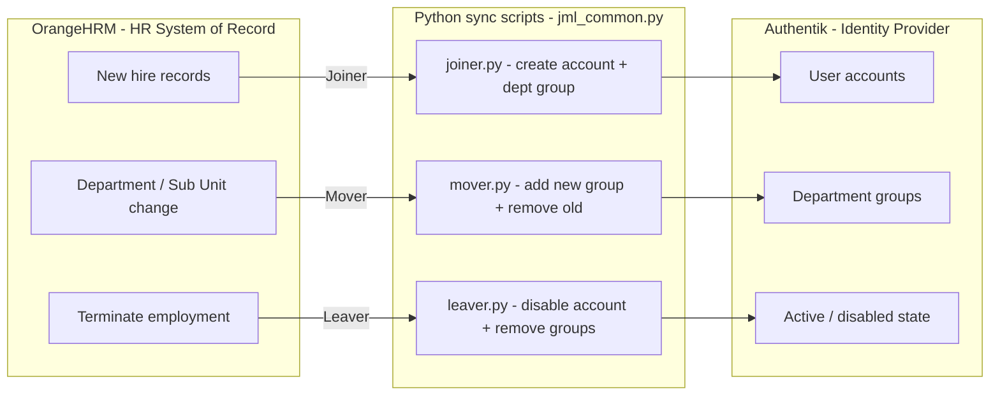

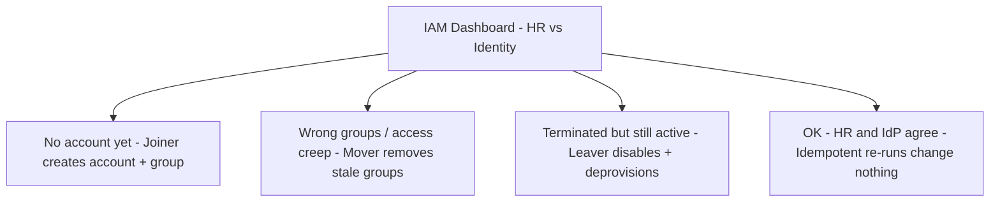

**Flow in plain language**

1. HR events originate in OrangeHRM (new hire, department change, termination).
2. The matching Python script applies the required Authentik change via `jml_common.py`.
3. The dashboard compares every OrangeHRM employee to their Authentik account and surfaces findings until the result is **11 rows · 0 finding(s)**.

> Lab stack: OrangeHRM 5.8.1 · Authentik 2026.8.5 · Python sync via `jml_common` · Educational lab environment

---

## Implementation / Steps

> **Evidence note:** Screenshots below are extracted from the lab guide’s documented “YOU SHOULD SEE” outcomes. They illustrate the intended workflow from the PDF. They are **not** claimed as personal production evidence. Scripts are filled in via lab TODOs inside the dashboard environment.

### Step 1 — Lab setup (two browser tabs)

Keep the **IAM Dashboard** and **OrangeHRM** open side by side. The dashboard asks for its password because it can run code on the lab. Log in to OrangeHRM as `admin` with the welcome-email password. OrangeHRM lands on the dashboard and does not force a password change.

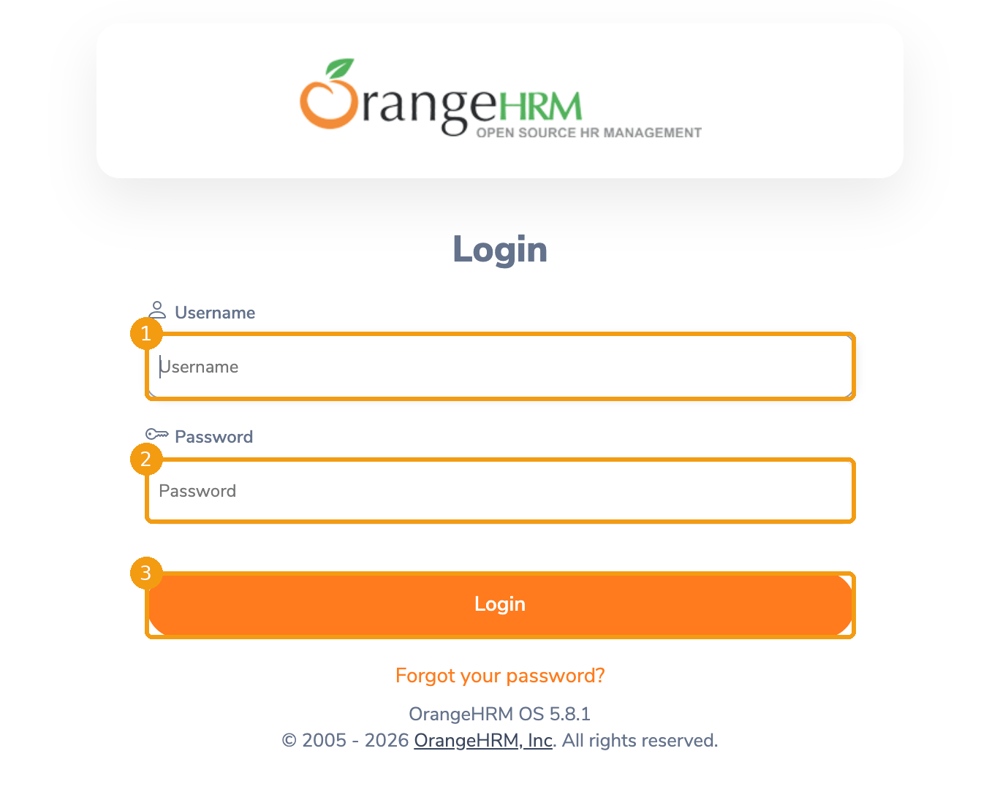

*Figure: OrangeHRM admin login (lab guide).*

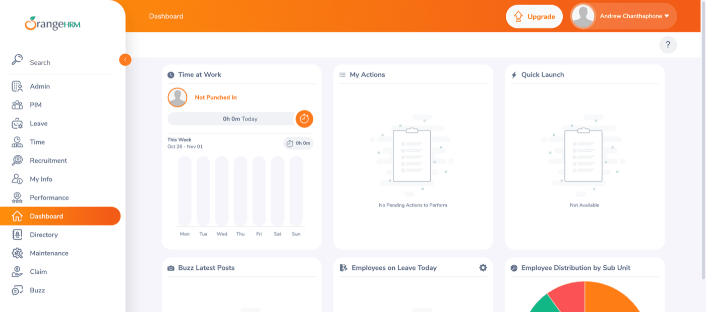

*Figure: OrangeHRM dashboard after login (lab guide).*

### Step 2 — Initial analysis (Analyst): HR vs Identity

Nobody on an IAM team should change access without first knowing what is there. Open **1 · HR vs Identity**. The tab places every OrangeHRM employee next to their Authentik account.

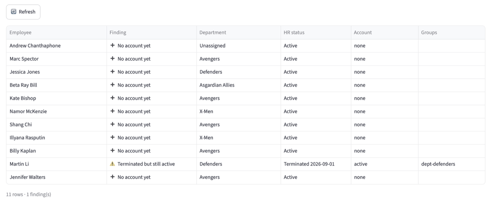

*Figure: Starting state — **11 rows · 1 finding**. Ten people show “No account yet”; Martin Li is terminated in HR but still active in Authentik with `dept-defenders` (lab guide).*

**Why Martin’s row is the most dangerous finding on this screen:** a terminated employee can still log in and still holds group access. The lab intentionally leaves him for the leaver (Step 04)—the joiner must not “fix” terminated users by creating or updating them as if they were active hires.

### Step 3 — Joiner workflow (Engineer): `joiner.py` TODOs 1–2

**Why:** a new hire should be able to log in on day one without filing a ticket. HR already knows they are coming, so HR should drive provisioning. In a real company the joiner may also send a welcome / enrollment link; this lab focuses on creating the account and department group—the part access depends on.

Open **2 · Build your scripts** → `joiner.py`. Run once **before** editing so you can see the ten new hires detected with TODO 1 incomplete.

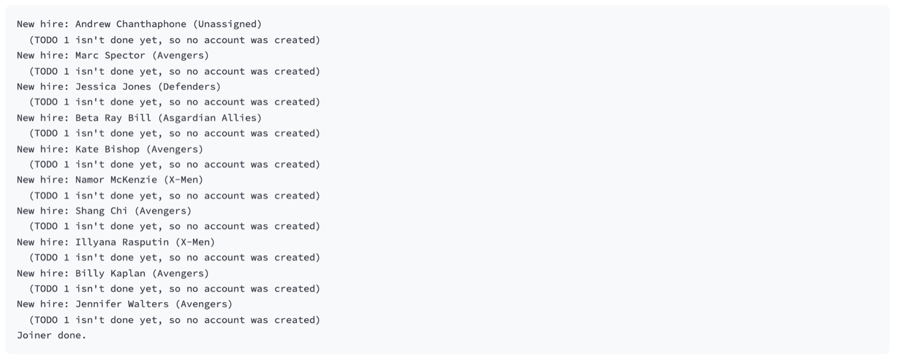

*Figure: Untouched joiner finds all ten hires and changes nothing (lab guide).*

Complete:

1. **TODO 1** — replace `user = None` with the account-create call named in the comment.
2. **TODO 2** — add the new user to their department’s group (same indent as the TODO comments).

Save, then Run. Documented output includes an **Unassigned** hire mapped to `dept-unassigned`, plus department groups such as `dept-avengers`, `dept-defenders`, and `dept-x-men`.

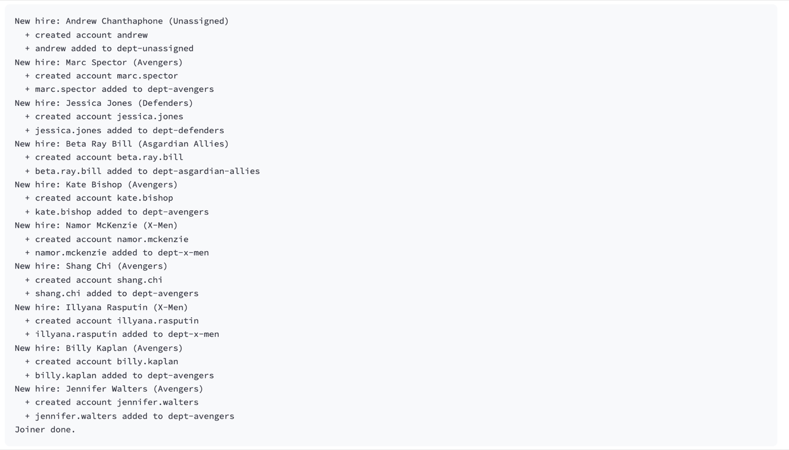

*Figure: Ten new hires processed — each account created and added to the matching `dept-*` group, including `dept-unassigned` for Unassigned (lab guide).*

Refresh **HR vs Identity**. Every active employee shows **OK**. The joiner **skips anyone HR has terminated**, so Martin’s finding remains: **10 OK and 1 finding left**.

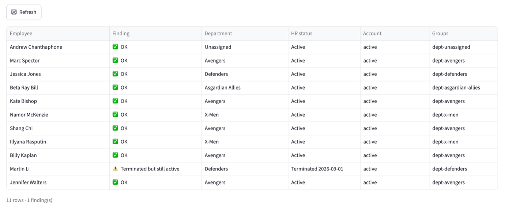

*Figure: Post-joiner reconciliation — 10 OK rows; Martin still terminated-but-active (lab guide).*

### Step 4 — Mover scenario (Analyst → Engineer): Kate Bishop transfer

**Why:** people change jobs inside a company all the time. What they should keep and what they should lose is where many real access problems start.

In OrangeHRM: **PIM → Kate Bishop → Job**. Change **Sub Unit** from **Avengers** to **X-Men** and Save (“Successfully Updated”). HR now shows X-Men; identity does not know yet.

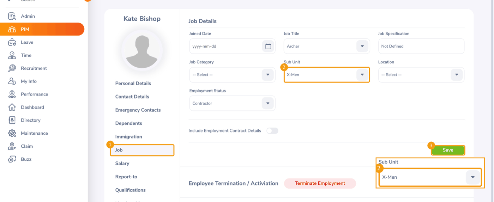

*Figure: Kate moved to X-Men in HR; identity not yet corrected (lab guide).*

The mover script **already adds the new group**. Running it as-is produces:

```text
Mover: Kate Bishop is now in X-Men
  + kate.bishop added to dept-x-men
Mover done.
```

Notice what the output does **not** say: nothing was taken away.

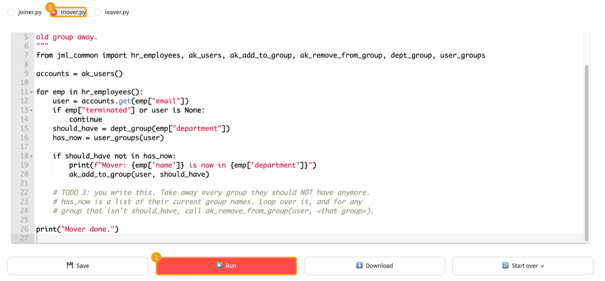

*Figure: Incomplete mover adds `dept-x-men` only (lab guide).*

After Refresh, Kate is flagged **Wrong groups**: she is in `dept-avengers` **and** `dept-x-men`. That is **access creep**—nothing broke; she can do the new job and the old one. Multiplied across years of transfers, this is the audit pattern where one person retains access from every prior team.

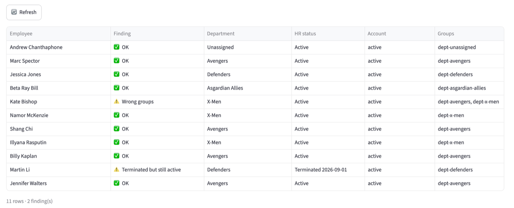

*Figure: Access creep — Kate retains `dept-avengers` while also holding `dept-x-men` (lab guide).*

### Step 5 — Complete the mover: TODO 3 and idempotency

In `mover.py`, **TODO 3** is where the old group is removed. Write a loop that removes every group the user has that is **not** the one they should have. After Save + Run:

```text
  - kate.bishop removed from dept-avengers
Mover done.
```

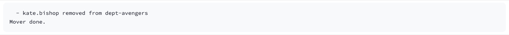

*Figure: TODO 3 removes the obsolete Avengers group (lab guide).*

Refresh again: Kate shows **OK** with only `dept-x-men`. Run the mover a second time—it prints only `Mover done.` A good sync script can run many times and **only change what is wrong** (idempotency).

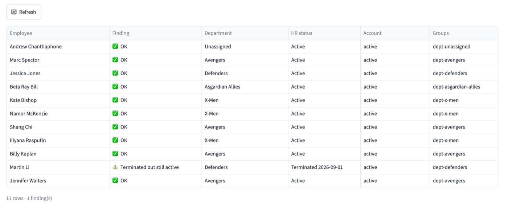

*Figure: Kate OK with only `dept-x-men`; HR and identity agree again (lab guide).*

### Step 6 — Leaver workflow (Analyst → Engineer): Jessica + Martin

**Why:** when someone leaves, every hour their account stays on is a risk—and it is often the first thing an auditor checks.

In OrangeHRM: **Jessica Jones → Job → Terminate Employment**. Pick today’s date and any reason, then Save. Her name shows **(Past Employee)**. Her Authentik login is still on until the leaver runs.

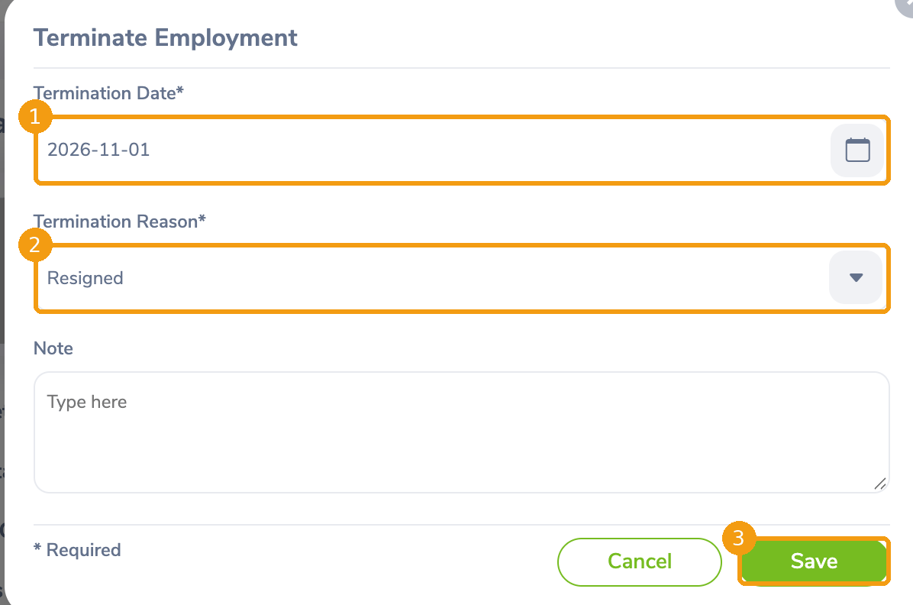

*Figure: Jessica listed as a past employee in HR; login still on until remediation (lab guide).*

Refresh **HR vs Identity**. There are now **two** leavers who can still log in: **Martin** (from the start) and **Jessica**.

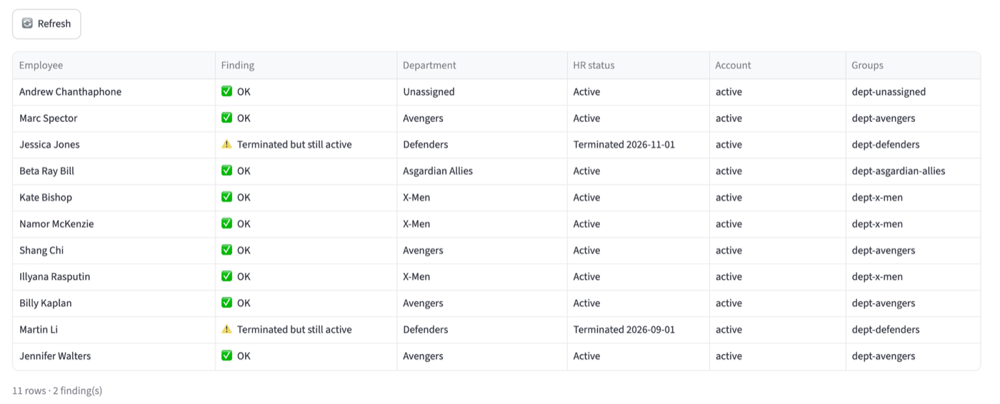

*Figure: Two findings — Martin Li and Jessica Jones terminated in HR but still active in Authentik (lab guide).*

Open `leaver.py`. Steps are written as comments; implement code under **TODOs 4, 5, 6, and 7** (building on patterns already used in joiner and mover). After Save + Run, documented output:

```text
  - disabled account jessica.jones
  - jessica.jones removed from dept-defenders
  - disabled account martin.li
  - martin.li removed from dept-defenders
Leaver done.
```

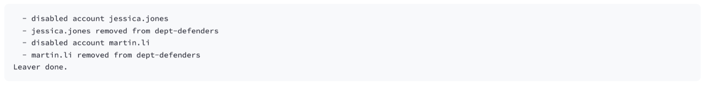

*Figure: Both leavers handled — accounts disabled and department groups removed (lab guide).*

### Step 7 — Final reconciliation

Refresh **HR vs Identity** one last time.

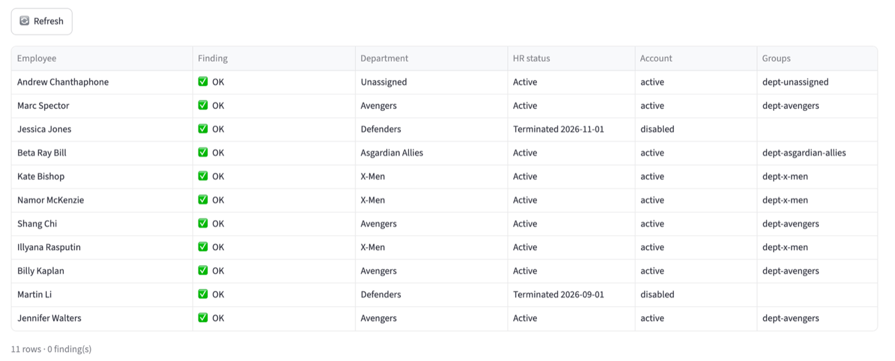

*Figure: Final documented state — **11 rows · 0 findings**. Terminated users show disabled accounts and empty groups; active users match department memberships (lab guide).*

---

## Key Findings / Results

Documented outcomes from the lab guide (not invented metrics):

| Stage | Documented result |
|-------|-------------------|
| Initial analysis | **11 rows · 1 finding** — ten “No account yet”; Martin Li terminated but still active in `dept-defenders` |
| After joiner | Ten new hires get accounts + department groups (including `dept-unassigned`); joiner skips terminated; **10 OK · 1 finding** |
| After incomplete mover | Kate flagged **Wrong groups** (`dept-avengers` + `dept-x-men`) — access creep |
| After TODO 3 mover | Kate **OK** with only `dept-x-men`; second run makes no unnecessary changes |
| After Jessica termination (pre-leaver) | **Two** terminated-but-still-active findings (Martin + Jessica) |
| After leaver (TODOs 4–7) | Both accounts disabled; department groups removed |
| Final reconciliation | **11 rows · 0 findings** — HR and Authentik agree |

---

## Portfolio Requirements (from Lab Guide)

The lab asks for a public repository with the three downloaded scripts plus a README that covers the template below.

### Repository artifacts

| Artifact | Status in this folder |
|----------|------------------------|
| `joiner.py` | **Add from lab dashboard Download** (not present in `scripts/` yet) |
| `mover.py` | **Add from lab dashboard Download** (not present in `scripts/` yet) |
| `leaver.py` | **Add from lab dashboard Download** (not present in `scripts/` yet) |
| `jml_common.py` | Lab-provided helper used by the scripts (reads OrangeHRM; calls Authentik API) |
| `README.md` | This document |

### What it does

Keeps an identity provider (**Authentik**) in sync with an HR system (**OrangeHRM**): new hires get an account and a department group, transfers swap groups (add new / remove old), and terminations disable the account and remove its groups.

### What it runs on

The scripts use **`jml_common.py`**, a helper module the lab provides. It reads employees from the OrangeHRM database and calls the Authentik API. Scripts are completed via TODOs in the IAM Lab Dashboard script builder, then downloaded for the portfolio.

### How I built it

> **[Personal input needed]** Two or three sentences in your own words. Which script was hardest, and why? (Do not invent experience—write this after you complete the TODOs.)

### The bug I fixed

> **[Personal input needed]** Describe **access creep** in your own words, and what **TODO 3** changed (removing obsolete department groups after Kate’s Avengers → X-Men move).

### What I’d improve for a real company

> **[Personal input needed]** Pick one (or add your own): run on a schedule instead of a button; log every change for audit; require approval before disabling an executive’s account; or another improvement you thought of.

### Where I built it

In a **personal / educational lab environment, not in production.**

> **Keep it honest (from the lab guide):** “I built JML automation in my lab” is true and strong. Do not let a résumé turn this into production experience it is not.

---

## Skills Demonstrated

- Identity lifecycle automation (joiner / mover / leaver)
- HR-driven provisioning with OrangeHRM as source of truth
- Identity reconciliation and finding classification (HR vs Identity)
- Access creep detection and remediation (TODO 3)
- Account disablement and group deprovisioning on termination (TODOs 4–7)
- Handling department edge cases (including Unassigned → `dept-unassigned`)
- Idempotent sync design (safe re-runs)
- Python scripting against an identity API via a shared helper module
- Translating lab concepts to enterprise IAM vocabulary (Entra ID, Okta, SailPoint)

---

## Real-World Relevance / Enterprise IAM Mapping

You built this on open-source tools. Platforms in job postings do the same work with their own names. **This is a concepts map, not a claim that you know these products.**

| What this lab builds | Microsoft Entra ID | Okta | SailPoint IdentityIQ |
|----------------------|--------------------|------|----------------------|
| OrangeHRM as the source of truth | HR-driven (inbound) provisioning | An HR app (e.g. Workday) as the profile source | An authoritative application |
| `joiner.py` | Joiner workflow in Lifecycle Workflows | User created from the profile source | Lifecycle event, type Create |
| Department to group | Dynamic membership group (e.g. `user.department -eq "Sales"`) | Group rule on the department attribute | Role assignment rule on an identity attribute |
| `mover.py` removing the old group | Mover workflow; dynamic group drops the user when the attribute changes | Group rule removes the user when the department changes | Lifecycle event, type Attribute Change |
| `leaver.py` | Leaver workflow: disable account, remove from groups | Deactivation driven by the profile source | Lifecycle event on active → terminated, triggering deprovisioning |

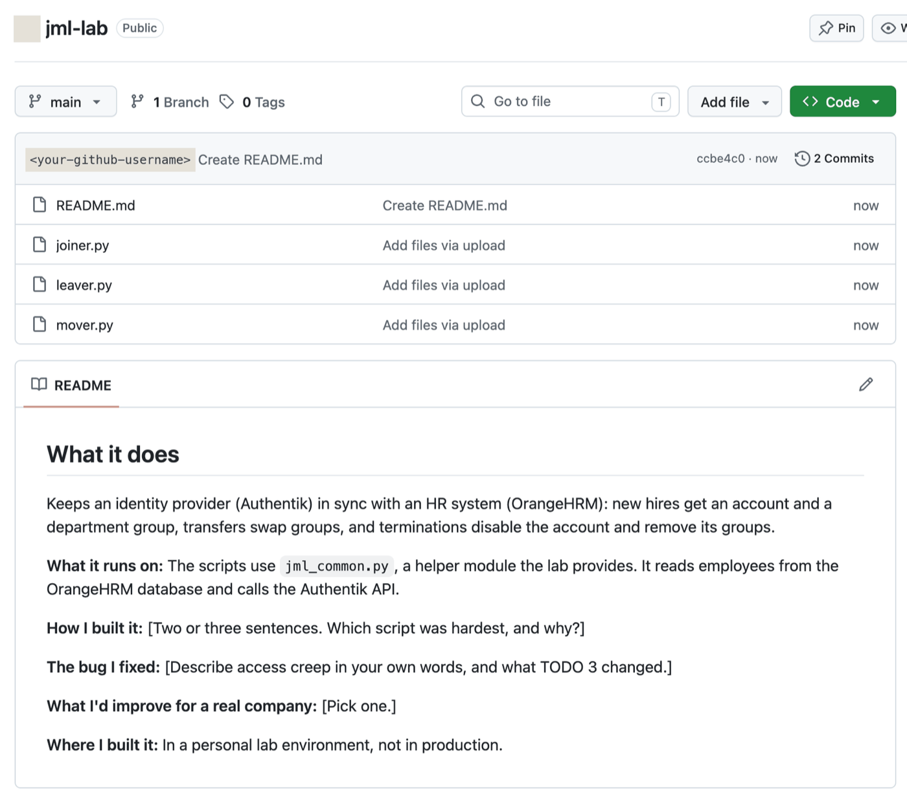

*Figure: Lab-to-enterprise concept map from the source guide (concepts map only—not product experience).*

*Guide sources checked 2026-09-27: Microsoft Learn (HR-driven provisioning, Entra ID Governance lifecycle automation, dynamic membership groups); Okta Help Center (group rules, profile sourcing); SailPoint IdentityIQ 8.2 Lifecycle Manager and Application Configuration guides.*

---

## Challenges / Lessons Learned

Supported directly by the lab narrative:

- **Terminated-but-active is the highest-risk initial finding** — access that should already be gone is still usable (Martin Li).
- **Access creep is quiet** — after Kate’s transfer, nothing “broke”; she could do the new job *and* the old one until TODO 3 removed stale groups.
- **Sync scripts should be idempotent** — a correct mover can re-run and only change what is wrong.
- **Analyst then engineer** — inspect drift before writing the fix; real IAM jobs require both.

---

## Summary

This lab documents end-to-end employee lifecycle automation in an educational environment: reconcile HR against identity, provision joiners (including unassigned department handling), correct movers without leaving excess access, and deprovision leavers until reconciliation reports **0 findings**. The open-source stack (OrangeHRM + Authentik + Python) maps conceptually to lifecycle patterns named in Entra ID, Okta, and SailPoint IdentityIQ job descriptions.

---

## Disclaimer

This work is based on an **educational hands-on IAM lab** (All Things Identity — Hands-on IAM Labs · Lab 1 · Guide v3) in a **personal lab environment, not production**.

References to Microsoft Entra ID, Okta, and SailPoint IdentityIQ are a **concepts map only**—not a claim of hands-on production experience with those products.

Screenshots embedded here come from the lab guide’s documented outcomes and should not be presented as independent production evidence.
